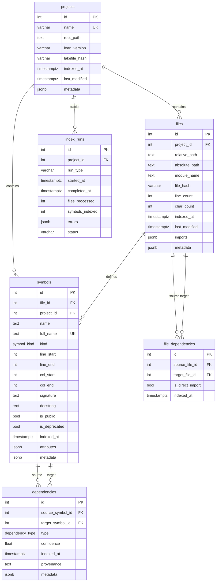

# Database Schema Overview

## Entity Relationship Diagram



## Enum Types

### symbol_kind
- `theorem` - Mathematical theorems
- `def` - Definitions
- `axiom` - Axioms
- `instance` - Type class instances
- `inductive` - Inductive types
- `structure` - Structures
- `class` - Type classes
- `constant` - Constants
- `opaque` - Opaque definitions
- `abbrev` - Abbreviations

### dependency_type
- `direct` - Direct symbol reference
- `implicit` - Implicit dependency
- `import` - Module import
- `indirect` - Transitive dependency

## Materialized Views

### dependency_stats
Aggregates per-symbol centrality metrics:
- `symbol_id` - Symbol ID (PK)
- `full_name` - Symbol full name
- `name` - Symbol short name
- `kind` - Symbol kind
- `project_id` - Project ID
- `outgoing_dependencies` - Count of outgoing edges
- `incoming_dependencies` - Count of incoming edges
- `total_connections` - Sum of incoming + outgoing
- `fan_out_ratio` - Ratio of outgoing to incoming

**Indexes:**
- `idx_dependency_stats_symbol_id`
- `idx_dependency_stats_project_id`
- `idx_dependency_stats_incoming` (DESC)

### module_metrics
Aggregates per-module statistics:
- `file_id` - File ID (PK)
- `module_name` - Module name
- `project_id` - Project ID
- `total_symbols` - Total symbol count
- `theorem_count` - Count by kind
- `proof_completion` - `float` — `(theorem_count - sorry_in_proof_count) / theorem_count`; 1.0 = fully proved
- `def_count` - Count by kind
- `axiom_count` - Count by kind
- `instance_count` - Count by kind
- `inductive_count` - Count by kind
- `structure_count` - Count by kind
- `class_count` - Count by kind
- `constant_count` - Count by kind
- `opaque_count` - Count by kind
- `abbrev_count` - Count by kind
- `avg_symbol_length_lines` - Average lines per symbol
- `max_symbol_length_lines` - Maximum symbol length
- `public_symbols` - Count of public symbols
- `deprecated_symbols` - Count of deprecated symbols
- `documented_symbols` - Count with docstrings
- `documentation_coverage_pct` - Percentage documented

**Indexes:**
- `idx_module_metrics_file_id`
- `idx_module_metrics_project_id`
- `idx_module_metrics_total_symbols` (DESC)
- `idx_module_metrics_module_name`

## Key Indexes

### B-tree Indexes
Standard B-tree indexes for equality and range queries:
- `idx_projects_name` - Project name lookup
- `idx_projects_last_modified` - Recent projects
- `idx_files_project_id` - Files by project
- `idx_files_module_name` - Files by module
- `idx_files_last_modified` - Recent file changes
- `idx_files_hash` - File hash lookup
- `idx_symbols_file_id` - Symbols by file
- `idx_symbols_project_id` - Symbols by project
- `idx_symbols_name` - Symbol name search
- `idx_symbols_full_name` - Full name lookup
- `idx_symbols_kind` - Symbols by kind
- `idx_deps_source` - Dependencies from symbol
- `idx_deps_target` - Dependencies to symbol
- `idx_deps_type` - Dependencies by type
- `idx_deps_composite` - Composite source+target
- `idx_file_deps_source` - File deps from file
- `idx_file_deps_target` - File deps to file

### GIN Indexes
Generalized Inverted Indexes for JSONB and full-text search:
- `idx_files_imports_gin` - JSONB containment on imports
- `idx_symbols_attributes_gin` - JSONB containment on attributes
- `idx_symbols_fts` - Full-text search on docstring+name

## Query Patterns

### Transitive Dependencies (CTE)
```sql
WITH RECURSIVE dep_tree AS (
    SELECT id, full_name, 0 AS depth FROM symbols WHERE full_name = ?
    UNION ALL
    SELECT s.id, s.full_name, dt.depth + 1
    FROM dep_tree dt
    JOIN dependencies d ON dt.id = d.source_symbol_id
    JOIN symbols s ON d.target_symbol_id = s.id
    WHERE dt.depth < ?
)
SELECT * FROM dep_tree WHERE depth > 0;
```

### Reverse Dependencies (CTE)
```sql
WITH RECURSIVE reverse_deps AS (
    SELECT id, full_name, 0 AS depth FROM symbols WHERE full_name = ?
    UNION ALL
    SELECT s.id, s.full_name, rd.depth + 1
    FROM reverse_deps rd
    JOIN dependencies d ON rd.id = d.target_symbol_id
    JOIN symbols s ON d.source_symbol_id = s.id
    WHERE rd.depth < ?
)
SELECT * FROM reverse_deps WHERE depth > 0;
```

### Cycle Detection (CTE)
```sql
WITH RECURSIVE cycles AS (
    SELECT id AS start, id AS current, ARRAY[id] AS path
    FROM symbols WHERE project_id = ?
    UNION ALL
    SELECT c.start, s.id, c.path || s.id
    FROM cycles c
    JOIN dependencies d ON c.current = d.source_symbol_id
    JOIN symbols s ON d.target_symbol_id = s.id
    WHERE s.id != ANY(c.path[2:])
)
SELECT * FROM cycles WHERE current = start AND array_length(path, 1) > 1;
```

### Most Used Symbols
```sql
SELECT s.full_name, COUNT(d.id) AS usage_count
FROM symbols s
LEFT JOIN dependencies d ON s.id = d.target_symbol_id
WHERE s.project_id = ?
GROUP BY s.id, s.full_name
HAVING COUNT(d.id) > 0
ORDER BY usage_count DESC
LIMIT ?;
```

## Performance Considerations

1. **Concurrent Indexing**: All indexes created with `CONCURRENTLY` flag
2. **JSONB Queries**: Use GIN indexes for containment queries (`@>`, `?`)
3. **Full-Text Search**: Use `to_tsvector` with GIN index for text search
4. **Materialized Views**: Refresh periodically with `REFRESH MATERIALIZED VIEW`
5. **Recursive CTEs**: Limit depth to prevent infinite loops
6. **Connection Pooling**: Use asyncpg pool or pgbouncer for production

## Refresh Materialized Views

```sql
-- Manual refresh
REFRESH MATERIALIZED VIEW dependency_stats;
REFRESH MATERIALIZED VIEW module_metrics;

-- Concurrent refresh (non-blocking, requires unique index)
REFRESH MATERIALIZED VIEW CONCURRENTLY dependency_stats;
```

## Foreign Key Cascade Rules

All foreign keys use `ON DELETE CASCADE` to maintain referential integrity:
- Deleting a **project** cascades to files, symbols, and index_runs
- Deleting a **file** cascades to symbols and file_dependencies
- Deleting a **symbol** cascades to dependencies

This ensures no orphaned records in the database.

## Lean/Wolfram Audit Mapping Extension

Decision: extend the existing PostgreSQL schema rather than create a separate graph database. The current `files`, `symbols`, `dependencies`, and `file_dependencies` tables already model project-local Lean source and symbol edges. The mapping layer adds narrowly scoped tables around that core for non-local imports, Wolfram companion files, audit tickets, obligations, and future attestations.

Draft migration: `0005_mapping_audit_context.py` adds the tables and views below for database-admin review.

### Additional Tables

`lean_import_references`

- Purpose: direct Lean imports that do not resolve to a project-local file, including Mathlib, lake packages, external cloned repos, and unresolved imports.
- Key fields: `project_id`, `source_file_id`, `import_name`, `target_scope`, `package_name`, `resolved_path`, `is_resolved`, `metadata`.
- Important indexes: `(project_id, import_name)`, `(project_id, target_scope)`, `metadata` GIN.

`wolfram_companion_maps`

- Purpose: parsed companion maps from `../wolfram_lean_maps/*.wl`, linked to `files` when the matching Lean module exists.
- Key fields: `project_id`, `file_id`, `module_name`, `wolfram_path`, `file_hash`, `raw_text`, `parsed_map`, optional `llm_synthesis`, `metadata`.
- Important indexes: `(project_id, module_name)`, `file_id`, `parsed_map` GIN, `llm_synthesis` GIN.

`audit_tickets`

- Purpose: Postgres-backed ticket store for FastAPI/Go forum flow outputs while preserving the `tk_<ulid>` ID shape.
- Key fields: `ticket_id`, `project_id`, `flow_name`, `ticket_type`, `title`, `description`, `input_json`, `output_json`, `status`, `duration_ms`, `tags`, `metadata`.
- Important indexes: `(project_id, flow_name)`, `status`, `created_at DESC`, `tags` GIN, `output_json` GIN.

`proof_obligations`

- Purpose: queryable unresolved work items from audit flows, proof metrics, doc/import drift, and Wolfram-map gaps.
- Key fields: `project_id`, optional `file_id`, optional `symbol_id`, optional `ticket_id`, `obligation_type`, `severity`, `status`, line span, `title`, `details`, `evidence`.
- Important indexes: `(file_id, status)`, `(symbol_id, status)`, `(project_id, obligation_type)`, partial open-obligation index, `evidence` GIN.

`ots_stamps`

- Purpose: future OpenTimestamps evidence over modules, tickets, maps, snapshots, or badges.
- Key fields: `project_id`, optional `ticket_id`, `subject_type`, `subject_key`, `subject_digest`, `stamp_provider`, `stamp_payload`, `verification_status`, nullable `bitcoin_block`.
- Contract note: `bitcoin_block` remains nullable for pending stamps; public and sovereign badges require a confirmed stamp with a non-null block.

`l2bl4_badges`

- Purpose: L2BL4 badge issuance linked to evidence, tickets, and optional OTS stamps.
- Key fields: `badge_id`, `project_id`, optional `ticket_id`, `subject_type`, `subject_key`, optional `subject_digest`, `badge_type`, `badge_class`, `issuance_status`, optional `ots_stamp_id`, optional `composite_sig_hash`, `contract_version`, `issued_to`, `issued_by`, `evidence`, `metadata`.
- Contract note: `badge_class` is one of `public`, `sovereign`, or `keepsake`; `badge_type` remains the producer/domain label.

### L2BL4 Evidence Contract

Migration `0006_l2bl4_evidence_contract.py` keeps the badge contract generic: no Yang-Mills, Millennium, or current-project flow names are hardcoded into validity. Project-specific audit evidence stays in `audit_tickets.output_json` and badge `evidence`.

Issued badge validity is:

- `keepsake`: `audit_tickets.status = 'success'`; the trigger records a `keepsake_unverified` marker.
- `public`: keepsake rule plus an `ots_stamps.ticket_id` row, `ots_stamps.bitcoin_block IS NOT NULL`, and a matching sorry obligation count.
- `sovereign`: public rule plus `l2bl4_badges.composite_sig_hash IS NOT NULL`.

The current row-oriented obligation representation uses `v_l2bl4_ticket_evidence_contract.reported_sorry_gated_count` from `audit_tickets.output_json` and `sorry_obligation_count` from sorry-like `proof_obligations` linked to the same `ticket_id`. Missing `sorry_gated`/`sorry_count` keys are accepted only when the linked sorry-like obligation count is zero.

### Query Views

`v_module_import_edges` unions project-local edges and external imports into a single adjacency surface:

```sql
SELECT *
FROM v_module_import_edges
WHERE project_id = $1 AND source_module = $2
ORDER BY target_scope, target_module;
```

`v_module_json_lookup` returns a chart-ready JSONB document per module:

```sql
SELECT module_json
FROM v_module_json_lookup
WHERE project_id = $1 AND module_name = $2;
```

`v_cohesion_ranking` provides the database-backed successor to the current static cohesion flow:

```sql
SELECT module_name, inbound_local_edges, outbound_local_edges,
       external_import_refs, wolfram_map_count,
       unresolved_obligation_count, proof_completion, cohesion_score
FROM v_cohesion_ranking
WHERE project_id = $1
ORDER BY cohesion_score DESC, module_name
LIMIT $2;
```

`v_unresolved_obligations` gives the worklist surface:

```sql
SELECT module_name, symbol_full_name, obligation_type, severity, title, evidence
FROM v_unresolved_obligations
WHERE project_id = $1
ORDER BY severity DESC, created_at DESC;
```

`v_l2bl4_ticket_evidence_contract` gives the endpoint-ready evidence gate:

```sql
SELECT ticket_id, audit_success, has_ticket_ots_stamp,
       has_confirmed_ots_stamp, reported_sorry_gated_count,
       sorry_obligation_count, obligation_count_matches, public_ready
FROM v_l2bl4_ticket_evidence_contract
WHERE ticket_id = $1;
```

`v_l2bl4_badge_validity` gives the current badge status after issuance:

```sql
SELECT badge_id, badge_class, issuance_status,
       is_currently_valid, contract_status, contract_error
FROM v_l2bl4_badge_validity
WHERE badge_id = $1;
```

### Recursive Query Patterns

Project-local module reachability should stay parameterized instead of materializing all source-target pairs by default:

```sql
WITH RECURSIVE module_walk AS (
    SELECT
        f.id AS file_id,
        f.module_name,
        0 AS depth,
        ARRAY[f.id] AS path
    FROM files f
    WHERE f.project_id = $1 AND f.module_name = $2

    UNION ALL

    SELECT
        target.id,
        target.module_name,
        module_walk.depth + 1,
        module_walk.path || target.id
    FROM module_walk
    JOIN file_dependencies fd ON fd.source_file_id = module_walk.file_id
    JOIN files target ON target.id = fd.target_file_id
    WHERE module_walk.depth < $3
      AND NOT target.id = ANY(module_walk.path)
)
SELECT * FROM module_walk WHERE depth > 0;
```

Inbound dependents use the same shape with `fd.target_file_id = module_walk.file_id` and `source.id = fd.source_file_id`.

External imports should be joined after the local walk, not recursively followed until external repos are indexed as first-class projects:

```sql
SELECT import_name, target_scope, package_name, resolved_path, metadata
FROM lean_import_references
WHERE project_id = $1 AND source_file_id = $2
ORDER BY target_scope, import_name;
```

### Staged Implementation

Phase 1: apply the draft migration and keep current ingestion unchanged. Backfill `lean_import_references` from `files.imports` by subtracting imports already represented in `file_dependencies`. Backfill `wolfram_companion_maps` from `../wolfram_lean_maps/*.wl` using file hash plus a minimal parser that stores raw text and coarse JSON sections.

Phase 2: persist audit-router executions into `audit_tickets` and emit `proof_obligations` for sorries, admits, declared axioms, proof-map drift, unresolved external imports, missing Wolfram maps, and failed flow runs. Keep Go SQLite tickets as a compatibility cache until Go_Red can dual-write or call the FastAPI ticket endpoint.

Phase 3: add API routes over `v_module_json_lookup`, `v_module_import_edges`, `v_cohesion_ranking`, and `v_unresolved_obligations`. Cache responses in Redis using the existing `lean4:cache:` convention and invalidate by file/project after watcher updates.

Phase 4: add OTS and L2BL4 producers. OTS writes should hash canonical JSON evidence at the application layer, then insert `ots_stamps` with nullable `bitcoin_block` until confirmation. Badge issuance should call `l2bl4_badge_contract_error(...)`, reference the same `subject_digest`, and store `l2bl4_ticket_evidence_snapshot(ticket_id)` inside `l2bl4_badges.evidence`.

Phase 5: if external repos need reachability, index each external repo as its own `projects` row and add cross-project import resolution metadata before considering a graph database. PostgreSQL recursive CTEs are sufficient for the current module count and charting needs.
