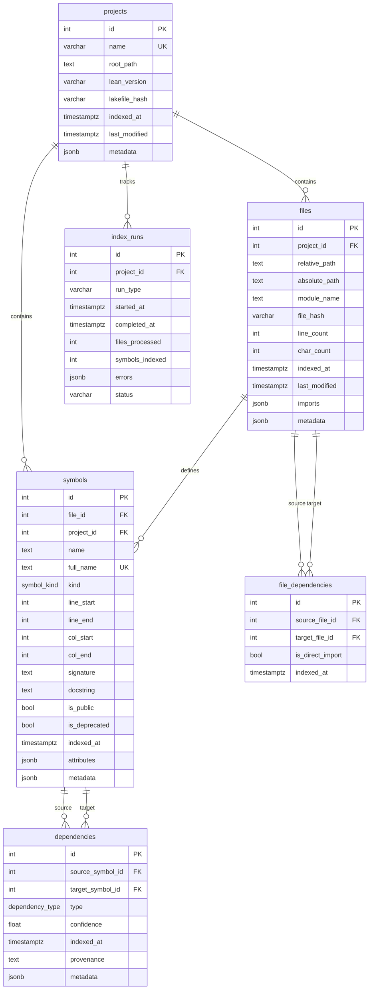

# Database Schema Overview

## Entity Relationship Diagram



## Enum Types

### symbol_kind
- `theorem` - Mathematical theorems
- `def` - Definitions
- `axiom` - Axioms
- `instance` - Type class instances
- `inductive` - Inductive types
- `structure` - Structures
- `class` - Type classes
- `constant` - Constants
- `opaque` - Opaque definitions
- `abbrev` - Abbreviations

### dependency_type
- `direct` - Direct symbol reference
- `implicit` - Implicit dependency
- `import` - Module import
- `indirect` - Transitive dependency

## Materialized Views

### dependency_stats
Aggregates per-symbol centrality metrics:
- `symbol_id` - Symbol ID (PK)
- `full_name` - Symbol full name
- `name` - Symbol short name
- `kind` - Symbol kind
- `project_id` - Project ID
- `outgoing_dependencies` - Count of outgoing edges
- `incoming_dependencies` - Count of incoming edges
- `total_connections` - Sum of incoming + outgoing
- `fan_out_ratio` - Ratio of outgoing to incoming

**Indexes:**
- `idx_dependency_stats_symbol_id`
- `idx_dependency_stats_project_id`
- `idx_dependency_stats_incoming` (DESC)

### module_metrics
Aggregates per-module statistics:
- `file_id` - File ID (PK)
- `module_name` - Module name
- `project_id` - Project ID
- `total_symbols` - Total symbol count
- `theorem_count` - Count by kind
- `def_count` - Count by kind
- `axiom_count` - Count by kind
- `instance_count` - Count by kind
- `inductive_count` - Count by kind
- `structure_count` - Count by kind
- `class_count` - Count by kind
- `constant_count` - Count by kind
- `opaque_count` - Count by kind
- `abbrev_count` - Count by kind
- `avg_symbol_length_lines` - Average lines per symbol
- `max_symbol_length_lines` - Maximum symbol length
- `public_symbols` - Count of public symbols
- `deprecated_symbols` - Count of deprecated symbols
- `documented_symbols` - Count with docstrings
- `documentation_coverage_pct` - Percentage documented

**Indexes:**
- `idx_module_metrics_file_id`
- `idx_module_metrics_project_id`
- `idx_module_metrics_total_symbols` (DESC)
- `idx_module_metrics_module_name`

## Key Indexes

### B-tree Indexes
Standard B-tree indexes for equality and range queries:
- `idx_projects_name` - Project name lookup
- `idx_projects_last_modified` - Recent projects
- `idx_files_project_id` - Files by project
- `idx_files_module_name` - Files by module
- `idx_files_last_modified` - Recent file changes
- `idx_files_hash` - File hash lookup
- `idx_symbols_file_id` - Symbols by file
- `idx_symbols_project_id` - Symbols by project
- `idx_symbols_name` - Symbol name search
- `idx_symbols_full_name` - Full name lookup
- `idx_symbols_kind` - Symbols by kind
- `idx_deps_source` - Dependencies from symbol
- `idx_deps_target` - Dependencies to symbol
- `idx_deps_type` - Dependencies by type
- `idx_deps_composite` - Composite source+target
- `idx_file_deps_source` - File deps from file
- `idx_file_deps_target` - File deps to file

### GIN Indexes
Generalized Inverted Indexes for JSONB and full-text search:
- `idx_files_imports_gin` - JSONB containment on imports
- `idx_symbols_attributes_gin` - JSONB containment on attributes
- `idx_symbols_fts` - Full-text search on docstring+name

## Query Patterns

### Transitive Dependencies (CTE)
```sql
WITH RECURSIVE dep_tree AS (
    SELECT id, full_name, 0 AS depth FROM symbols WHERE full_name = ?
    UNION ALL
    SELECT s.id, s.full_name, dt.depth + 1
    FROM dep_tree dt
    JOIN dependencies d ON dt.id = d.source_symbol_id
    JOIN symbols s ON d.target_symbol_id = s.id
    WHERE dt.depth < ?
)
SELECT * FROM dep_tree WHERE depth > 0;
```

### Reverse Dependencies (CTE)
```sql
WITH RECURSIVE reverse_deps AS (
    SELECT id, full_name, 0 AS depth FROM symbols WHERE full_name = ?
    UNION ALL
    SELECT s.id, s.full_name, rd.depth + 1
    FROM reverse_deps rd
    JOIN dependencies d ON rd.id = d.target_symbol_id
    JOIN symbols s ON d.source_symbol_id = s.id
    WHERE rd.depth < ?
)
SELECT * FROM reverse_deps WHERE depth > 0;
```

### Cycle Detection (CTE)
```sql
WITH RECURSIVE cycles AS (
    SELECT id AS start, id AS current, ARRAY[id] AS path
    FROM symbols WHERE project_id = ?
    UNION ALL
    SELECT c.start, s.id, c.path || s.id
    FROM cycles c
    JOIN dependencies d ON c.current = d.source_symbol_id
    JOIN symbols s ON d.target_symbol_id = s.id
    WHERE s.id != ANY(c.path[2:])
)
SELECT * FROM cycles WHERE current = start AND array_length(path, 1) > 1;
```

### Most Used Symbols
```sql
SELECT s.full_name, COUNT(d.id) AS usage_count
FROM symbols s
LEFT JOIN dependencies d ON s.id = d.target_symbol_id
WHERE s.project_id = ?
GROUP BY s.id, s.full_name
HAVING COUNT(d.id) > 0
ORDER BY usage_count DESC
LIMIT ?;
```

## Performance Considerations

1. **Concurrent Indexing**: All indexes created with `CONCURRENTLY` flag
2. **JSONB Queries**: Use GIN indexes for containment queries (`@>`, `?`)
3. **Full-Text Search**: Use `to_tsvector` with GIN index for text search
4. **Materialized Views**: Refresh periodically with `REFRESH MATERIALIZED VIEW`
5. **Recursive CTEs**: Limit depth to prevent infinite loops
6. **Connection Pooling**: Use asyncpg pool or pgbouncer for production

## Refresh Materialized Views

```sql
-- Manual refresh
REFRESH MATERIALIZED VIEW dependency_stats;
REFRESH MATERIALIZED VIEW module_metrics;

-- Concurrent refresh (non-blocking, requires unique index)
REFRESH MATERIALIZED VIEW CONCURRENTLY dependency_stats;
```

## Foreign Key Cascade Rules

All foreign keys use `ON DELETE CASCADE` to maintain referential integrity:
- Deleting a **project** cascades to files, symbols, and index_runs
- Deleting a **file** cascades to symbols and file_dependencies
- Deleting a **symbol** cascades to dependencies

This ensures no orphaned records in the database.
