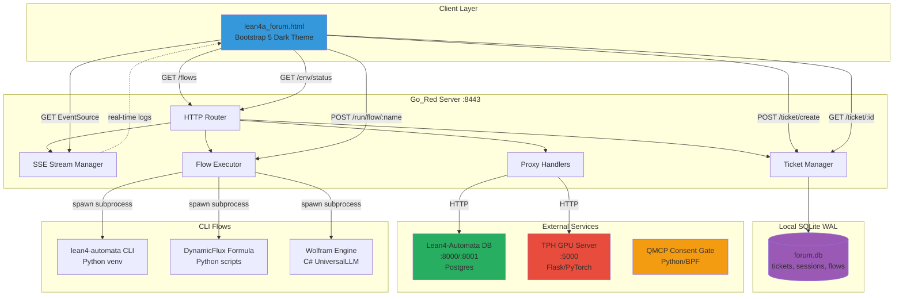

# Lean4-Automata Forum Architecture
## Complete Design for Forum-Style UI + Go CLI Harness

---

## 1. Architecture Diagram



---

## 2. Component Overview

### 2.1 Go_Red Extended Server
**Port:** 8443  
**Existing:** QMCP consent gate, BPF F-Regulator, SQLite bridge  
**New Additions:**
- Flow execution engine with subprocess management
- Server-Sent Events (SSE) for real-time log streaming
- Ticket-based result storage
- Proxy endpoints for Lean4-Automata and TPH
- Python environment status checker

### 2.2 Forum SQLite Database
**Path:** `~/.lean4a/forum.db` (configurable via `LEAN4A_FORUM_DB`)  
**Mode:** WAL (Write-Ahead Logging) for concurrent reads  
**Purpose:** Local-first storage of findings, never leaves user machine

### 2.3 Forum HTML Interface
**File:** `lean4a_forum.html`  
**Framework:** Bootstrap 5.3, Font Awesome 6.4  
**Theme:** Dark gradient (matching existing TPH UIs)  
**Features:**
- Left sidebar: Flow buttons with icons
- Center: Live log panel (SSE stream)
- Right: Tickets panel (collapsible JSON)
- Top: Session selector, status badges

### 2.4 Named CLI Flows
**Execution Model:** Go spawns subprocess, streams stdout via SSE, stores result as ticket

---

## 3. API Contract

### 3.1 Flow Execution

#### `POST /run/flow/{flow_name}`
Execute a named CLI flow and stream output via SSE.

**Path Parameters:**
- `flow_name` (string): Name of the flow to execute

**Request Body:**
```json
{
  "input": {
    "query": "optional user query",
    "params": {}
  }
}
```

**Response:** SSE stream
```
event: log
data: {"level":"info","message":"Starting lean_sorry_scan..."}

event: log
data: {"level":"stdout","message":"Found 23 sorry statements"}

event: result
data: {"ticket_id":"tk_abc123","status":"success"}

event: done
data: {"duration_ms":2340}
```

#### `GET /flows`
List all available flows.

**Response:**
```json
{
  "flows": [
    {
      "name": "lean_sorry_scan",
      "description": "Scan Lean4 codebase for sorry statements",
      "params_schema": {
        "file_pattern": {"type": "string", "default": "*.lean"}
      },
      "tags": ["lean", "sorry"]
    }
  ]
}
```

### 3.2 Ticket Management

#### `POST /ticket/create`
Create a new result ticket.

**Request Body:**
```json
{
  "flow_name": "lean_sorry_scan",
  "input_json": {"query": "*.lean"},
  "output_json": {"sorries": 23, "files": [...]},
  "status": "success",
  "tags": ["lean", "sorry"]
}
```

**Response:**
```json
{
  "ticket_id": "tk_abc123",
  "created_at": "2025-05-07T12:34:56Z"
}
```

#### `GET /ticket/{id}`
Retrieve a ticket by ID.

**Response:**
```json
{
  "id": "tk_abc123",
  "flow_name": "lean_sorry_scan",
  "input_json": {...},
  "output_json": {...},
  "status": "success",
  "created_at": "2025-05-07T12:34:56Z",
  "tags": ["lean", "sorry"]
}
```

#### `GET /tickets`
List tickets with optional filtering.

**Query Parameters:**
- `session_id` (optional): Filter by session
- `tags` (optional): Comma-separated tags
- `limit` (optional): Max results (default: 50)

**Response:**
```json
{
  "tickets": [
    {
      "id": "tk_abc123",
      "flow_name": "lean_sorry_scan",
      "status": "success",
      "created_at": "2025-05-07T12:34:56Z",
      "tags": ["lean", "sorry"]
    }
  ],
  "total": 1
}
```

### 3.3 Proxy Endpoints

#### `POST /lean/query`
Proxy to Lean4-Automata query API.

**Request Body:**
```json
{
  "query": "SELECT * FROM v_proof_status WHERE sorry_count > 0"
}
```

**Response:**
```json
{
  "ticket_id": "tk_xyz789",
  "results": [...]
}
```

#### `POST /tph/inference`
Proxy to TPH GPU server.

**Request Body:**
```json
{
  "tokens": [42, 17, 89],
  "max_length": 50
}
```

**Response:**
```json
{
  "ticket_id": "tk_def456",
  "logits": [...],
  "speech_output": {...}
}
```

### 3.4 Environment Status

#### `GET /env/status`
Check Python environment status.

**Response:**
```json
{
  "venv_active": true,
  "venv_path": "/root/workspace/.venv",
  "python_version": "3.11.5",
  "packages": {
    "torch": "2.1.0",
    "lean4-automata": "0.1.0"
  },
  "gpu_available": true,
  "gpu_name": "AMD MI300X"
}
```

### 3.5 Session Management

#### `POST /session/create`
Create a new session.

**Request Body:**
```json
{
  "name": "Proof Strategy Session"
}
```

**Response:**
```json
{
  "session_id": "sess_abc123",
  "created_at": "2025-05-07T12:34:56Z"
}
```

#### `POST /session/{id}/add_ticket`
Add a ticket to a session.

**Request Body:**
```json
{
  "ticket_id": "tk_abc123"
}
```

---

## 4. Data Model

### SQLite Schema (WAL Mode)

```sql
-- Tickets: stored findings from flow executions
CREATE TABLE tickets (
    id TEXT PRIMARY KEY,  -- tk_<ulid>
    flow_name TEXT NOT NULL,
    input_json TEXT NOT NULL,  -- JSON string
    output_json TEXT NOT NULL,  -- JSON string
    status TEXT NOT NULL CHECK(status IN ('success', 'error', 'timeout')),
    error_message TEXT,
    created_at INTEGER NOT NULL,  -- Unix timestamp
    duration_ms INTEGER,
    tags TEXT  -- JSON array: ["lean", "sorry"]
);

CREATE INDEX idx_tickets_flow ON tickets(flow_name);
CREATE INDEX idx_tickets_status ON tickets(status);
CREATE INDEX idx_tickets_created ON tickets(created_at DESC);

-- Sessions: group tickets together
CREATE TABLE sessions (
    id TEXT PRIMARY KEY,  -- sess_<ulid>
    name TEXT NOT NULL,
    created_at INTEGER NOT NULL,
    ticket_ids_json TEXT  -- JSON array of ticket IDs
);

CREATE INDEX idx_sessions_created ON sessions(created_at DESC);

-- Flow definitions: metadata about available flows
CREATE TABLE flow_definitions (
    name TEXT PRIMARY KEY,
    description TEXT NOT NULL,
    params_schema TEXT NOT NULL,  -- JSON schema
    handler_type TEXT NOT NULL,  -- 'subprocess', 'proxy'
    command_template TEXT,  -- For subprocess flows
    enabled BOOLEAN NOT NULL DEFAULT 1
);

-- Flow execution log (circular buffer, keep last 1000)
CREATE TABLE flow_logs (
    id INTEGER PRIMARY KEY AUTOINCREMENT,
    flow_name TEXT NOT NULL,
    ticket_id TEXT,
    level TEXT NOT NULL,  -- info, error, stdout, stderr
    message TEXT NOT NULL,
    timestamp INTEGER NOT NULL
);

CREATE INDEX idx_flow_logs_ticket ON flow_logs(ticket_id);
CREATE INDEX idx_flow_logs_timestamp ON flow_logs(timestamp DESC);
```

---

## 5. Flow Definitions

### Flow Configuration Format

Each flow is defined in the `flow_definitions` table and loaded at startup:

```go
type FlowDefinition struct {
    Name            string          `json:"name"`
    Description     string          `json:"description"`
    ParamsSchema    json.RawMessage `json:"params_schema"`
    HandlerType     string          `json:"handler_type"` // subprocess, proxy
    CommandTemplate string          `json:"command_template"`
    Enabled         bool            `json:"enabled"`
    Tags            []string        `json:"tags"`
}
```

### Predefined Flows

#### 1. `lean_sorry_scan`
**Description:** Scan Lean4 codebase for sorry statements  
**Handler:** subprocess  
**Command:**
```bash
python3 -c "
import requests
resp = requests.get('http://localhost:8000/query', json={'query': 'SELECT * FROM v_proof_status WHERE sorry_count > 0'})
print(resp.json())
"
```

#### 2. `lean_float_scan`
**Description:** Query floating symbols (definitions without proofs)  
**Handler:** subprocess  
**Command:**
```bash
python3 -c "
import requests
resp = requests.get('http://localhost:8000/query', json={'query': 'SELECT * FROM v_floating_symbols LIMIT 100'})
print(resp.json())
"
```

#### 3. `lean_diff_mathlib`
**Description:** Compare local Lean files against mathlib (placeholder)  
**Handler:** subprocess  
**Command:**
```bash
echo '{\"status\": \"not_implemented\", \"message\": \"Mathlib diff requires lake integration\"}'
```

#### 4. `tph_inference`
**Description:** Run token inference through TPH model  
**Handler:** proxy → `http://localhost:5000/inference`  
**Params:** `{"tokens": [int], "max_length": int}`

#### 5. `formula_match`
**Description:** Match DynamicFlux Python formula against Lean symbols  
**Handler:** subprocess  
**Command:**
```bash
python3 /path/to/dynamicflux_formula_matcher.py --formula "$INPUT"
```

#### 6. `wolfram_verify`
**Description:** Verify mathematical formula via Wolfram Engine  
**Handler:** subprocess  
**Command:**
```bash
dotnet run --project /path/to/UniversalLLMOrchestrator verify --formula "$INPUT"
```

#### 7. `env_check`
**Description:** Validate Python environment and dependencies  
**Handler:** subprocess  
**Command:**
```bash
python3 -c "
import sys, importlib.metadata
print(f'Python: {sys.version}')
for pkg in ['torch', 'requests', 'flask']:
    try:
        v = importlib.metadata.version(pkg)
        print(f'{pkg}: {v}')
    except:
        print(f'{pkg}: NOT INSTALLED')
"
```

---

## 6. Security & Resilience

### 6.1 Security Patterns

1. **Local-First Privacy**
   - All findings stored in local SQLite DB
   - No automatic external transmission
   - Export functionality requires explicit user action

2. **Command Injection Prevention**
   - Flow commands use templates with parameterized substitution
   - Input validation before subprocess execution
   - Whitelist of allowed flow names

3. **Rate Limiting**
   - Max 5 concurrent flow executions per client
   - SSE connection timeout: 5 minutes
   - Flow execution timeout: 30 seconds (configurable)

### 6.2 Resilience Patterns

1. **Timeout Handling**
   - All subprocess executions have configurable timeouts
   - SSE streams auto-close on timeout
   - Tickets marked as "timeout" status

2. **Error Recovery**
   - Failed flows logged with full error context
   - Retry button in UI for failed flows
   - Flow execution errors stored in ticket

3. **Graceful Degradation**
   - If Lean DB unavailable, flows return cached results
   - If TPH GPU server down, UI shows offline status
   - Python env check fails gracefully

---

## 7. Observability

### 7.1 Logging Strategy

**Levels:** info, error, stdout, stderr  
**Format:** Structured JSON logs
```json
{
  "timestamp": "2025-05-07T12:34:56Z",
  "level": "info",
  "flow_name": "lean_sorry_scan",
  "ticket_id": "tk_abc123",
  "message": "Flow execution started",
  "duration_ms": 0
}
```

### 7.2 Metrics

Tracked in-memory, exposed via `/metrics`:
- Flow execution count (by flow name)
- Flow success/error rate
- Average execution duration
- Active SSE connections
- Ticket creation rate

### 7.3 Health Checks

#### `GET /health`
```json
{
  "status": "healthy",
  "uptime_seconds": 3600,
  "checks": {
    "database": "ok",
    "lean_db": "ok",
    "tph_server": "ok",
    "bpf": "ok"
  }
}
```

---

## 8. Deployment Model

### 8.1 Prerequisites
- Go 1.21+
- SQLite 3.35+ (WAL support)
- Python 3.11+ with venv
- Lean4-Automata DB running on localhost:8000
- TPH GPU server running on localhost:5000

### 8.2 Startup Sequence
1. Go_Red loads existing BPF program
2. Opens/creates `~/.lean4a/forum.db` in WAL mode
3. Seeds `flow_definitions` table if empty
4. Starts HTTP server on :8443
5. HTML UI served from `/forum` endpoint

### 8.3 Configuration
Environment variables:
- `LEAN4A_FORUM_DB` — SQLite database path (default: `~/.lean4a/forum.db`)
- `LEAN_DB_URL` — Lean4-Automata query URL (default: `http://localhost:8000`)
- `TPH_SERVER_URL` — TPH GPU server URL (default: `http://localhost:5000`)
- `FLOW_TIMEOUT_SEC` — Flow execution timeout (default: `30`)
- `MAX_CONCURRENT_FLOWS` — Max parallel flows (default: `5`)

---

## 9. Testing Strategy

### 9.1 Unit Tests
- Flow parser and parameter substitution
- Ticket CRUD operations
- SSE message formatting

### 9.2 Integration Tests
- Flow execution with mock subprocess
- Proxy endpoints with mock Lean/TPH servers
- WAL database concurrent access

### 9.3 E2E Tests
- Full flow execution via HTTP API
- SSE connection and message delivery
- HTML UI button clicks (Playwright)

---

## 10. Future Enhancements

1. **Flow Chaining** — Execute flows in sequence with output piping
2. **Formula Library** — Searchable index of DynamicFlux formulas
3. **Proof Assistant** — Interactive Lean proof exploration
4. **Export Formats** — PDF, Markdown, JSON export of tickets
5. **Collaboration** — Share sessions via encrypted links
6. **AI Suggestions** — GPT-4 suggestions for proof strategies

---

## Architecture Decision Records

### ADR-001: Why SQLite Instead of Postgres?
**Context:** Need local storage for findings  
**Decision:** SQLite with WAL mode  
**Rationale:**
- Local-first privacy (no network transmission)
- Zero configuration for users
- WAL mode provides concurrent reads
- Sufficient for 10k+ tickets

### ADR-002: Why SSE Instead of WebSockets?
**Context:** Need real-time log streaming  
**Decision:** Server-Sent Events (SSE)  
**Rationale:**
- Simpler than WebSocket (unidirectional)
- Native browser support via EventSource
- Automatic reconnection
- HTTP/2 compatible

### ADR-003: Why Single-File HTML?
**Context:** Simplify deployment  
**Decision:** All JS/CSS inline in HTML  
**Rationale:**
- No build step required
- Easy to serve from Go's http.FileSystem
- Matches existing TPH UI pattern
- Reduces deployment complexity

---

